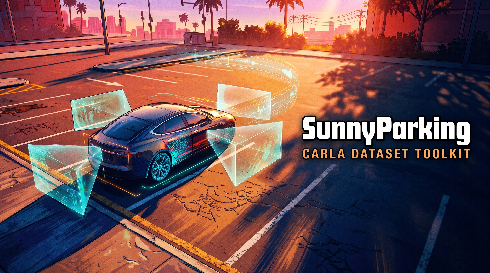

# SunnyParking CARLA Toolkit

Toolkit for our IEEE Access paper
[*SunnyParking: Multi-Shot Trajectory Generation and Motion State Awareness for Human-like Parking*](https://doi.org/10.1109/ACCESS.2026.3752444).

Companion to the paper dataset on Hugging Face: [MPRG/sunnyparking](https://huggingface.co/datasets/MPRG/sunnyparking) — collect human park-ins in CARLA, then recapture sensors from recording logs. The released dataset includes the original recorder logs, so you can restore each scene and recapture the sensor parameters you want.

Thanks to [e2e-parking-carla](https://github.com/qintonguav/e2e-parking-carla) for the codebase this toolkit builds on.

Keyboard or Logitech G29 (`wheel_config.ini`). Wheel throttle / brake / steer tracks a real car better than WASD.



- **[04/11/2026]** code release

## What it does

1. **Collect** — `carla_data_gen.py` in Town04: surround RGB/depth, measurements, `replay/recoding.log`
2. **Recap** — replay the log (or rebuild actors) and write only the sensors you ask for; RGB / measurements stay untouched

Depth recap is production-ready (`depth_front/left/right/rear`, 400×300, fov 100, same extrinsics as collection). Lidar / semantic configs exist but are not fully validated here.

## Setup

We tested this toolkit on **CARLA 0.9.13** (server and Python API must match). Newer CARLA builds are welcome — adapt the client / API and you can often get better simulation fidelity and sensor quality.

Prerequisites (both paths):

- CARLA server running (`./CarlaUE4.sh -prefernvidia`); keep the Python `carla` package on the same version as the server
- Recap needs per-task `measurements/`, `rgb_*`, and a replayable `replay/recoding.log`
- Optional: G29 via `wheel_config.ini`

For **sensor recapture**, you can run CARLA **offscreen / headless** (no display, no pygame UI) — e.g. `./CarlaUE4.sh -prefernvidia -RenderOffScreen` — then drive `carla_sensor_recap.py` from either Conda or Docker. 

<details>
<summary><b>Conda (host)</b></summary>

```bash
git clone https://github.com/jishumiao95/sunnyparking_carla_toolkit.git
cd sunnyparking_carla_toolkit
conda env create -f environment.yml
conda activate e2e

# Install CARLA Python API into this env (run from the CARLA 0.9.13 install root)
# Official egg is built for py3.7; setup_carla.sh unpacks it and pip-installs for py3.10.
cd /path/to/CARLA_0.9.13
bash /path/to/sunnyparking_carla_toolkit/setup_carla.sh
cd /path/to/sunnyparking_carla_toolkit

python -c "import carla; print(carla.__file__)"   # sanity check
```

No GPU / different CUDA: edit `environment.yml` — drop `pytorch-cuda=11.7` and add `cpuonly`, or change the CUDA package to match your driver.

</details>

<details>
<summary><b>Docker (client in container, CARLA on host)</b></summary>

Validated layout: CARLA server on the **host**, toolkit + dataset bind-mounted at **`/workspace`** inside the container. Symlinks and recap paths should stay as container paths (`/workspace/...`).

```bash
# Host: start CARLA first
./CarlaUE4.sh -prefernvidia

# Example container (adjust image / mounts). Prefer --network host so :2000 reaches the server.
docker run --gpus all -it --rm --network host \
  -v /home/USER/workspace:/workspace \
  -w /workspace/sunnyparking_carla_toolkit \
  nvidia/cuda:11.7.1-cudnn8-runtime-ubuntu22.04 bash
```

Inside the container:

```bash
# Miniconda (once), then the project env
# ... install miniconda, then:
cd /workspace/sunnyparking_carla_toolkit
conda env create -f environment.yml
conda activate e2e

# CARLA client — same as host path; point setup at the CARLA tree you mount or copy
cd /path/to/CARLA_0.9.13
bash /workspace/sunnyparking_carla_toolkit/setup_carla.sh
cd /workspace/sunnyparking_carla_toolkit

python -c "import carla; print(carla.__file__)"
```

When the host CARLA server opens recorder files, remap container → host paths (auto from `/proc/self/mountinfo`, or set explicitly):

```bash
--server_path_map /workspace=/home/USER/workspace
```

Recap / collect commands use container paths under `/workspace`. Keep `--host 127.0.0.1 --port 2000` with `--network host`.

</details>

## 1. Collect

```bash
./CarlaUE4.sh -prefernvidia
python3 carla_data_gen.py
```

Keyboard: `w/a/s/d` throttle/steer/brake, `q` reverse, `BackSpace` reset, `TAB` camera.  
G29: plug in before launch; axes/buttons under `[G29 Racing Wheel]` in `wheel_config.ini`.

Each task writes `rgb_*`, `depth_*`, `measurements/`, `parking_layout/`, `replay/recoding.log`.

## 2. Recap depth

Replay the log and fill in surround depth. Only selected sensors are written.

```bash
export DATASET_ROOT=/path/to/dataset          # has val_town04 / train_town04
export MIRROR_ROOT=/path/to/recap_mirror
```

Typical path: dry-run → one task / `--limit` → `--output_root` mirror → QA → symlink `depth_*` back into train/val.

### Inventory (no CARLA)

```bash
python3 carla_sensor_recap.py \
  --dry_run \
  --sensors depth \
  --splits $DATASET_ROOT/val_town04
```

### Smoke one task

```bash
python3 carla_sensor_recap.py \
  --host 127.0.0.1 --port 2000 \
  --splits $DATASET_ROOT/val_town04 \
  --sensors depth \
  --episode <episode_name> \
  --task task1 \
  --limit 1 \
  --output_root $MIRROR_ROOT \
  --server_path_map /workspace=/home/USER/workspace
```

### Full split → mirror

```bash
python3 carla_sensor_recap.py \
  --host 127.0.0.1 --port 2000 \
  --splits $DATASET_ROOT/val_town04 \
  --sensors depth \
  --output_root $MIRROR_ROOT \
  --target_fps 30 --save_frequency 3 \
  --server_path_map /workspace=/home/USER/workspace
```

Swap the split for train. Re-runs skip finished tasks; `--retry_failed` redoes only failures. Each task gets a `recap_manifest.json`; PNG count should match `measurements/`.

### Wire depth into the train path

`--output_root` is a separate mirror so the original set stays intact. Point `depth_*` at the mirror with symlinks (keep RGB / measurements in place; rename old dirs to `depth_*.old_symlinks` for rollback):

```bash
MIRROR=/path/to/recap_mirror
ORIG=/path/to/dataset
CAMS="depth_front depth_left depth_right depth_rear"

find "$MIRROR/val_town04" -mindepth 2 -maxdepth 2 -type d -name 'task*' | sort | while read -r src; do
  rel=${src#$MIRROR/}
  dst="$ORIG/$rel"
  test -d "$dst/measurements" || { echo "SKIP $rel"; continue; }
  for cam in $CAMS; do
    test -d "$src/$cam" || continue
    if [ -L "$dst/$cam" ]; then
      echo "already linked $rel/$cam"
      continue
    fi
    mv "$dst/$cam" "$dst/${cam}.old_symlinks"
    ln -s "$MIRROR/$rel/$cam" "$dst/$cam"
    echo "linked $rel/$cam"
  done
done
```

Same for `train_town04`. Skip this if training already points at the recap output.

### QA (optional)

```bash
python3 tool/pack_recap_stitched_zip.py \
  --split $DATASET_ROOT/val_town04 \
  --output_root $MIRROR_ROOT \
  --split_name val_town04 \
  --zip /tmp/recap_val_check.zip \
  --depth_vis

python3 tool/pack_recap_rgb_depth_zip.py --help
```

Longer operator checklist (QA / symlink / rollback): [sensor_recap_manual.md](./sensor_recap_manual.md)

## Layout

```text
carla_data_gen.py              # collection entry
carla_sensor_recap.py          # recap CLI
data_generation/sensor_recap.py
data_generation/sensor_specs.py
wheel_config.ini               # G29 axes / buttons
tool/pack_recap_*.py
tests/test_sensor_recap.py
```

## Citation

If you find this work helpful, please cite:

```bibtex
@ARTICLE{11789576,
  author={Miao, Jishu and Chen, Han and Zhai, Jiankun and Liu, Qi and Hirakawa, Tsubasa and Yamashita, Takayoshi and Fujiyoshi, Hironobu},
  journal={IEEE Access}, 
  title={SunnyParking: Multi-Shot Trajectory Generation and Motion State Awareness for Human-like Parking}, 
  year={2026},
  volume={},
  number={},
  pages={1-1},
  keywords={Modeling;Trajectory;Gears;Vehicles;Conferences;Educational institutions;Grounding;Planning;Autonomous driving;Computers;Automated parking;autonomous driving;end-to-end planning;imitation learning},
  doi={10.1109/ACCESS.2026.3752444}}
```

## License

Research use. CARLA, third-party weights, and datasets keep their own licenses. No enterprise checkpoints or private logs ship here.
